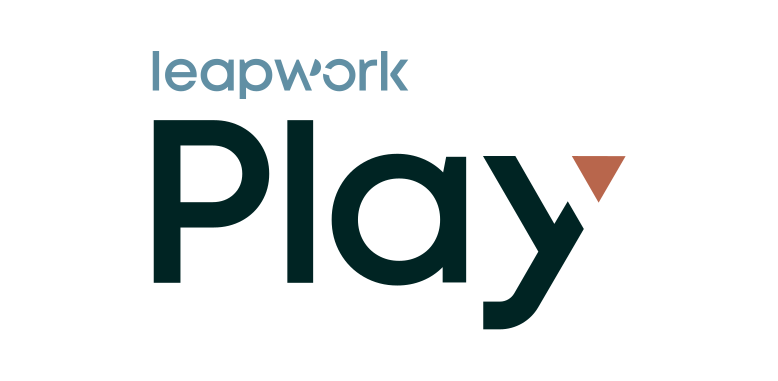

<picture>
  <source media="(prefers-color-scheme: dark)" srcset="play-claude-plugin/assets/play-logo-light-v-c.svg">
  
</picture>

# Leapwork Play agent plugins

Build, run and fix [Playwright](https://playwright.dev/)-based tests in [Leapwork Play](https://leapwork.ai/) from your coding agent. Each plugin connects the agent to the Leapwork Play MCP server at `https://mcp.leapwork.ai/mcp`, and every call runs with your own Leapwork Play account.

## Install

| Agent | Plugin folder | Install |
| --- | --- | --- |
| Claude Code | [`play-claude-plugin`](play-claude-plugin) | `/plugin marketplace add leapwork/agent-plugins`, then `/plugin install leapwork-play@leapwork` |
| Codex | [`play-codex-plugin`](play-codex-plugin) | `codex plugin marketplace add leapwork/agent-plugins`, then `codex plugin add leapwork-play@leapwork` |
| GitHub Copilot CLI | [`play-copilot-plugin`](play-copilot-plugin) | `copilot plugin marketplace add leapwork/agent-plugins`, then `copilot plugin install leapwork-play@leapwork` |
| Cursor | [`play-cursor-plugin`](play-cursor-plugin) | Install **Leapwork Play** from the Cursor Marketplace |
| Google Antigravity | [`play-antigravity-plugin`](play-antigravity-plugin) | Install **Leapwork Play** from the Antigravity Marketplace, or `agy plugin install ./play-antigravity-plugin` from a clone |

Each folder's `README.md` describes what the plugin does in that agent.

## Repository layout

Each agent reads its marketplace file from the repository root, and that file points to the agent's plugin folder:

| Marketplace file | Read by | Points to |
| --- | --- | --- |
| `.claude-plugin/marketplace.json` | Claude Code | `play-claude-plugin` |
| `.agents/plugins/marketplace.json` | Codex | `play-codex-plugin` |
| `.github/plugin/marketplace.json` | GitHub Copilot | `play-copilot-plugin` |
| `.cursor-plugin/marketplace.json` | Cursor | `play-cursor-plugin` |

Antigravity has no marketplace file; it installs from the `play-antigravity-plugin` folder.

Keep `version` in step across the plugin manifests and marketplace files when you release.

---

Playwright is a trademark of Microsoft Corporation. This project is not affiliated with or endorsed by Microsoft.
