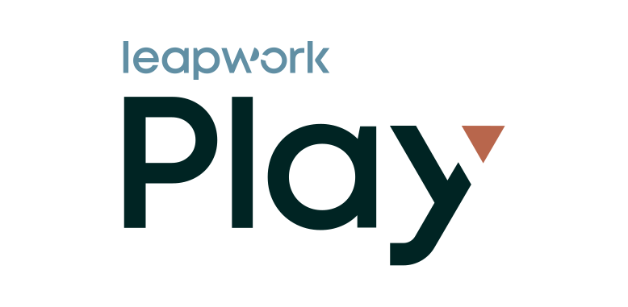

<picture>
  <source media="(prefers-color-scheme: dark)" srcset="play-logo-light-v-c.svg">
  
</picture>

# Leapwork Play for Google Antigravity

Connect Antigravity to Leapwork Play to create and record Playwright tests, run tests and runlists, investigate failures, and build agents. Sign in with your Leapwork Play account to use its existing access and permissions.

<!-- TODO: add a screenshot or short GIF: sign-in, then a prompt, then the resulting test -->

## What you can do

| Area | Examples |
| --- | --- |
| **Create** | Create test cases, or generate them from specs you upload to a knowledge base |
| **Record** | Describe a flow in plain English and Play records it as Playwright steps in a cloud browser |
| **Run** | Run a test case or a whole runlist, now or on a schedule, and see the results |
| **Debug and fix** | Find out why a run failed, fix the failing step, and rerun only the failed steps |
| **Build agents** | Create Leapwork agents that run on a schedule, an event or an API call |

## Before you start

You need:

- Google Antigravity. <!-- TODO: minimum version -->
- A [Leapwork Play](https://leapwork.ai/) account. <!-- TODO: add sign-up link and note any free tier/trial -->

## Sign in

The first time the plugin connects, Antigravity opens a browser sign-in for your Leapwork Play account. After sign-in, ask for Leapwork Play in chat.

## Try it

- "Create a test case in Leapwork Play for this bug."
- "Search Leapwork Play for test cases mentioning admin."
- "Open the failing test case in Leapwork Play and start a browser session."

## Working with Leapwork Play

- **Approvals and questions.** If Leapwork Play needs your approval or more detail, Antigravity shows the question and carries on after you answer.
- **Long jobs.** Bigger jobs, such as recording a flow in a browser, keep running while Leapwork Play works. Antigravity gets the result, or the next question, when it is ready.
- **Workspace and team.** If you have more than one, Antigravity asks which to use before it works with your tests.

## The Leapwork Play MCP server

The plugin connects Antigravity to the Leapwork Play MCP server at `https://mcp.leapwork.ai/mcp`. Every call runs with your own Leapwork Play permissions. The server gives Antigravity these tools:

| Tool | What it does |
| --- | --- |
| `play_get_skill` | Step-by-step instructions for a job, such as creating, running or debugging a test |
| `play_list_capabilities` | Lists everything Leapwork Play can do directly |
| `play_call_capability` | Runs one or more of those capabilities, such as creating a test case or starting a run |
| `play_call_workflow` | Hands a bigger job to Leapwork Play's AI, such as recording steps in a browser or fixing Playwright code |
| `play_get_pending` | Checks on a request that is still running or waiting for an answer |
| `play_respond` | Sends your answer to a question or approval from Leapwork Play |
| `play_cancel_workflow` | Stops a request that is still running |
| `play_get_artifacts` | Gets the screenshots and videos of a test run |

## Troubleshooting

**Antigravity can't reach Leapwork Play**

- Make sure Leapwork Play is reachable from your machine.
- Check that Leapwork Play is turned on under **Customizations → Installed**.

**The connection dropped during a job**

Ask Antigravity to check the pending Leapwork Play request and continue from there.

## Privacy

See the [Leapwork privacy policy](https://leapwork.com/legal/privacy-policy/).

---

Playwright is a trademark of Microsoft Corporation. This project is not affiliated with or endorsed by Microsoft.
