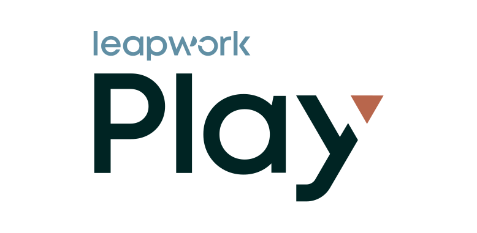

<picture>
  <source media="(prefers-color-scheme: dark)" srcset="assets/play-logo-light-v-c.svg">
  
</picture>

# Leapwork Play for Codex

Connect Codex to Leapwork Play to create and record Playwright tests, run tests and runlists, investigate failures, and build agents alongside your local work. Sign in with your Leapwork Play account to use its existing access and permissions.

## What you can do

| Area | Examples |
| --- | --- |
| **Create** | Create test cases, or generate them from specs you upload to a knowledge base |
| **Record** | Describe a flow in plain English and Play records it as Playwright steps in a cloud browser |
| **Run** | Run a test case or a whole runlist, now or on a schedule, and see the results |
| **Debug and fix** | Find out why a run failed, fix the failing step, and rerun only the failed steps |
| **Build agents** | Create Leapwork agents that run on a schedule, an event or an API call |

## Before you start

You need:

- Codex, signed in.
- A Leapwork Play account.

## Sign in

1. Start a new Codex session, since sessions that were already open don't see the plugin.
2. The first time Codex uses Leapwork Play, it asks you to sign in. Complete the sign-in in your browser.

## Try it

- "Create a test case in Leapwork Play for this bug."
- "Search Leapwork Play for test cases mentioning admin."
- "Open the failing test case in Leapwork Play and start a browser session."
- "Go to example.com, search for pencil, and record it as a Leapwork test."
- "Run TC-28 and tell me why it failed."
- "Run the smoke suite and summarise the failures."

## Working with Leapwork Play

- **Approvals and questions.** If Leapwork Play needs your approval or more detail, Codex shows the question and carries on after you answer.
- **Long jobs.** Bigger jobs, such as recording a flow in a browser, keep running while Leapwork Play works. Codex gets the result, or the next question, when it is ready.

## The Leapwork Play MCP server

The plugin connects Codex to the Leapwork Play MCP server at `https://mcp.leapwork.ai/mcp`. Every call runs with your own Leapwork Play permissions. The server gives Codex these tools:

| Tool | What it does |
| --- | --- |
| `play_get_skill` | Step-by-step instructions for a job, such as creating, running or debugging a test |
| `play_list_capabilities` | Lists everything Leapwork Play can do directly |
| `play_call_capability` | Runs one or more of those capabilities, such as creating a test case or starting a run |
| `play_call_workflow` | Hands a bigger job to Leapwork Play's AI, such as recording steps in a browser or fixing Playwright code |
| `play_get_pending` | Checks on a request that is still running or waiting for an answer |
| `play_respond` | Sends your answer to a question or approval from Leapwork Play |
| `play_cancel_workflow` | Stops a request that is still running |
| `play_get_artifacts` | Gets the screenshots and videos of a test run |

## Troubleshooting

**Codex can't reach Leapwork Play**

- Make sure Leapwork Play is reachable from your machine.
- Re-authenticate Leapwork Play when Codex prompts you.
- Start a new Codex session.

**You signed in, but it still can't connect**

Ask your Leapwork Play administrator to check that external MCP authentication is enabled for your Leapwork Play environment.

**Codex uses a different Leapwork Play connection**

If you also added Leapwork Play to Codex by hand, for example a dev, QA or localhost server, turn it off. It has the same tools as the plugin, and Codex may pick it instead.

**The connection dropped during a job**

Ask Codex to check the pending Leapwork Play request and continue from there.

## Privacy

See the [Leapwork privacy policy](https://leapwork.com/legal/privacy-policy/).

---

Playwright is a trademark of Microsoft Corporation. This project is not affiliated with or endorsed by Microsoft.
